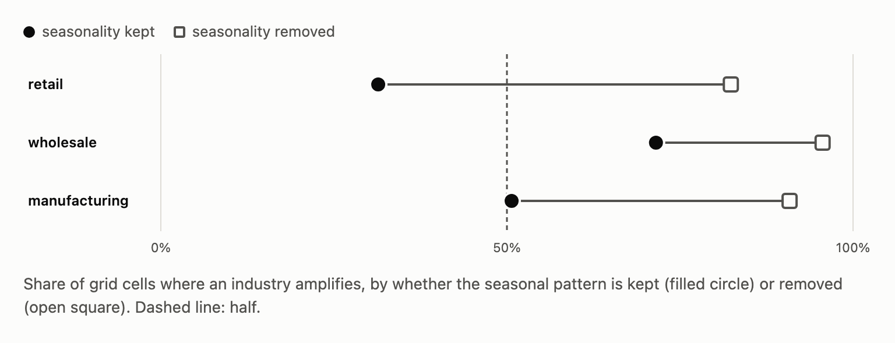

# bullwhip-audit

<!-- Hero card: rendered by tarang-tj/tarang-tj (node scripts/render-repo-hero.mjs bullwhip docs/img), same number as the profile tile. -->
<picture>
  <source media="(prefers-color-scheme: dark)" srcset="docs/img/hero-dark.svg">
  <source media="(prefers-color-scheme: light)" srcset="docs/img/hero-light.svg">
  
</picture>

[](https://github.com/tarang-tj/bullwhip-audit/actions/workflows/ci.yml)
[](https://tarang-tj.github.io/bullwhip-audit/)
[](LICENSE)
[](docs/method.md)

**Does order volatility really grow at each step up a supply chain?** A replication of Cachon, Randall and Schmidt (2007) on 34 years of US Census retail, wholesale and manufacturing data, extended through 2025. Keep the seasonal pattern in and most wholesale industries amplify in 87 of 96 measurement specifications, while most retail industries amplify in none. Take seasonality out and most industries in every tier look like amplifiers.

[](https://tarang-tj.github.io/bullwhip-audit/)

**[Live page](https://tarang-tj.github.io/bullwhip-audit/)** · [Findings memo](docs/findings.md) · [Method and sources](docs/method.md)

## Findings

The 2007 pattern holds as long as the seasonal pattern stays in the data. Most wholesale industries amplify in 87 of 96 measurement specifications; most retail industries amplify in none of them. Manufacturing changed: it mostly smoothed in 1993 to 2004 but amplifies under most settings since 2005. Remove seasonality and most industries in every tier look like amplifiers. In COVID, retail took the largest inventory swing of any tier. Full memo: [`docs/findings.md`](docs/findings.md).

## How it works

```
FRED (keyless CSV, 112 Census series) -> data/raw + sha256 manifest
  -> registry.py   44 non-overlapping industries + 3 aggregate tiers, live titles
  -> panel.py      production = sales + change in inventory; one measurement spec
  -> grid.py       11,880 rows (11,016 industry cells): window x margin x deflator x transform x frequency x adjustment
  -> findings.py   every printed number -> outputs/numbers.csv
  -> memo.py       docs/findings.md from a template; numbers come only from numbers.csv
  -> page.py       docs/index.html
```

## Reproduce

Requires Python 3.12 with pandas, numpy, scipy, markdown, pytest, ruff and playwright.

```
make all       # rebuild everything from the cached raw files (about a minute)
make refresh   # download the current vintage first (networked)
make gate      # lint, tests, independent reconcile, memo number check, browser probe
```

`make gate` fails on any of these:
- a raw file that doesn't match its manifest hash
- a headline ratio that an independent csv-and-numpy recompute doesn't reproduce to 1e-9
- a number in the memo that doesn't trace to `outputs/numbers.csv`
- a page that scrolls sideways, makes a network request or logs an error at 1440 or 375 px

Each check was broken on purpose once to confirm it goes red.

## License

Code: MIT. Memo and page text: CC BY 4.0. Census data: US government work, public domain.
